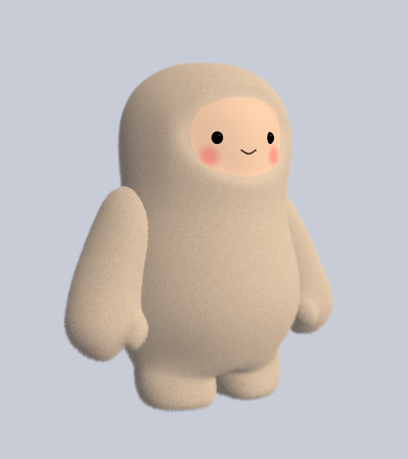

# The Muse avatar

The body the agent wears in VRChat: a fan-made avatar of Meta's Muse character, modeled in
Blender by Kasties during the hackathon (Oct 30 to Nov 2 2026). The agent works with any
avatar; this one just makes it Muse.

## Files

| Folder | What it holds |
|---|---|
| [`vrchat/`](vrchat) | The avatar as uploaded to VRChat (Nov 2): `Muse_Jolly.fbx`, a skinned mesh of 13,312 triangles with a 19-bone humanoid armature and the shape keys `Blink` and `MouthOpen`; `Muse_BaseColor.png`, the baked colours (2048×2048); `Fur/`, a shell-fur shader and material for Unity; and [the Unity and VRChat SDK steps](vrchat/Unity_VRChat_Steps.md) |
| [`blender/`](blender) | The first version (Oct 30): `Muse_VRChat.blend` with Blender particle fur, its FBX export, the fur and face textures, and preview renders |

The 13,312 triangles and 2 material slots rate **Excellent** on PC and **Medium** on Quest.
Blender's particle fur cannot be exported to VRChat, so the uploaded avatar fakes fur with the
shell shader in `vrchat/Fur`: the mesh is drawn once solid and 16 more times as see-through
shells pushed outward, and a fur pattern decides where hairs reach each shell.

## Avatar parameters

The agent drives two parameters over OSC (see the main README, "Avatar state"): `Thinking`
(Bool) while Muse Spark decides, and `Mood` (Int). Add them to the avatar's Expression
Parameters and animate them as you like; the avatar works without them.

## Credits

The Muse character is Meta's. The fur shader in `vrchat/Fur` is adapted from Sorumi's
[UnityFurShader](https://github.com/Sorumi/UnityFurShader) 0.4 and stays under its Apache 2.0
license ([`LICENSE-UnityFurShader.txt`](vrchat/Fur/LICENSE-UnityFurShader.txt)); its source
files say what was changed.
